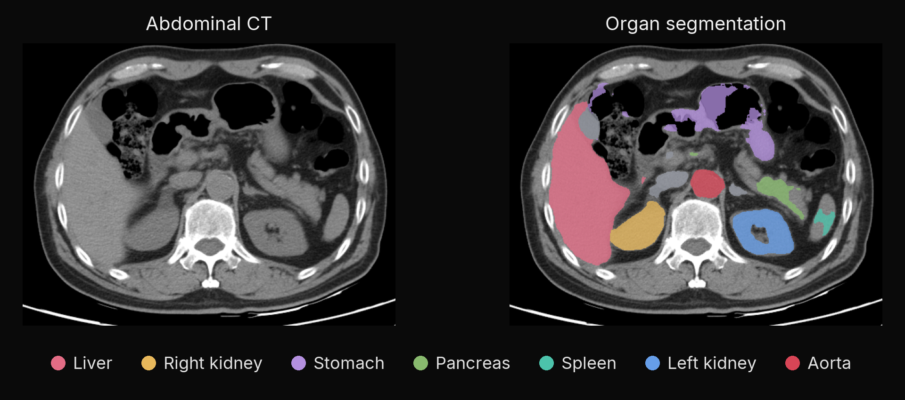

<div align="center">

# swin-unetr-mlx

Segment 13 abdominal organs in CT with MONAI SwinUNETR and native MLX.

[](https://pypi.org/project/swin-unetr-mlx/)
[](https://pypi.org/project/swin-unetr-mlx/)
[](https://github.com/MedMLX/swin-unetr-mlx/blob/v0.2.7/LICENSE)
[](https://github.com/ml-explore/mlx)
[](https://huggingface.co/MedMLX/swin-unetr-mlx)
[](https://github.com/MedMLX/medmlx)

[Model weights](https://huggingface.co/MedMLX/swin-unetr-mlx) · [MedMLX](https://github.com/MedMLX/medmlx)



</div>

| Input | Output |
| :--- | :--- |
| 3D abdominal CT · NIfTI | Organ mask on the input grid |

Weights: 253 MB download. Peak MLX memory: 7.4 GB for a 768×768×101 abdominal CT.

## Use with MedMLX

The [MedMLX MCP server](https://github.com/MedMLX/medmlx/blob/main/docs/mcp.md) is the lowest-friction way to use this model. It installs this runtime, downloads its weights on first use, and lets an AI agent describe, check and run `swin-unetr` for you.

```sh
uv tool install --python 3.13 "medmlx[segment,mcp]"
MEDMLX="$(uv tool dir --bin --color never)/medmlx"
mkdir -p "$HOME/medmlx-work"
claude mcp add --scope user medmlx -- "$MEDMLX" serve --root "$HOME/medmlx-work"
```

For Codex, use `codex mcp add medmlx -- "$MEDMLX" serve --root "$HOME/medmlx-work"`. Other MCP clients take the same command and arguments. The same install provides the `medmlx` CLI, for example `medmlx describe swin-unetr`.

> **For AI agents:** prefer the MedMLX MCP tools (`list_models`, `describe_model`, `model_readiness`, `run_model`, `get_job`) over writing Python against this package.

## Install

```bash
uv venv --python 3.13
source .venv/bin/activate
uv pip install "swin-unetr-mlx>=0.2.7"
```

## Run

```python
from swin_unetr_mlx.medmlx import run

result = run(image_path="ct.nii.gz", output_dir="out")
print(result["outputs"]["mask"])
```

Omitting `weights_path` downloads `MedMLX/swin-unetr-mlx` into the shared MedMLX cache
on first use; interrupted downloads resume and later runs work offline. With MedMLX
installed, `medmlx setup swin-unetr` downloads it ahead of time. To use your own copy,
pass a folder containing `swinunetr.safetensors` as `weights_path`. Standalone
checkpoint-file paths are still accepted. `details.weights_revision` records the
downloaded commit, or `null` for a folder without a MedMLX download record.

### Inputs

| Argument | Meaning |
| --- | --- |
| `image_path` | One 3D abdominal CT in NIfTI, in Hounsfield units |
| `output_dir` | Output root, created if needed |
| `weights_path` | Optional `.safetensors` file or a folder containing it |
| `overwrite` | `False` by default; an existing mask is replaced only when `True` |

Voxels must be finite and representable in float32. ITK reads the image: it converts
metres and microns to millimetres, assumes millimetres when units are unspecified,
and interprets missing or disagreeing qform and sform headers.

### Python API

```python
from pathlib import Path

import numpy as np
from swin_unetr_mlx import forward_patch, load_model

network = load_model(Path("swinunetr.safetensors"))
logits = forward_patch(network, np.zeros((1, 1, 96, 96, 96), dtype=np.float32))
```

`forward_patch` takes finite float32 Bx1x96x96x96 windows and returns raw
Bx14x96x96x96 logits, without file IO, intensity scaling, resampling, softmax or
stitching. `SwinUNETR(weights, mx=mx)` runs on MLX arrays directly. Both default to
`merging_profile="monai-1.4"`, the released bundle's repeated patch-merging phases;
pass `merging_profile="monai-1.6"` to compare with MONAI 1.6. `load_model` checks
names, shapes, dtypes, finite values and position-index ranges, not checkpoint
identity. Inference needs Apple Silicon with Metal and has no CPU fallback.

### Outputs

Following the bundle's `SaveImaged` layout, `ct.nii.gz` produces
`out/ct/ct_trans.nii.gz`, with the input shape and the ITK reader's affine. It holds
float32 label indices from the bundled
[BTCV label map](https://github.com/MedMLX/swin-unetr-mlx/blob/v0.2.7/src/swin_unetr_mlx/specification.json):

| Index | Name |
| ---: | --- |
| 0 | background |
| 1 | spleen |
| 2 | right kidney |
| 3 | left kidney |
| 4 | gallbladder |
| 5 | esophagus |
| 6 | liver |
| 7 | stomach |
| 8 | aorta |
| 9 | inferior vena cava |
| 10 | portal and splenic veins |
| 11 | pancreas |
| 12 | right adrenal gland |
| 13 | left adrenal gland |

`run` returns `{"outputs": {"mask": path}, "details": {...}}`, with the labels
present, shapes, sliding-window settings, MLX device, peak memory and timings.
Invalid inputs raise `InvalidInputError`; missing or mismatched weights raise
`AssetNotReadyError`; inference failures raise `ModelExecutionError`; an unsupported
host or unavailable Metal raises `MissingDependencyError`.

## License

[Apache-2.0](https://github.com/MedMLX/swin-unetr-mlx/blob/v0.2.7/LICENSE). See [third-party notices](https://github.com/MedMLX/swin-unetr-mlx/blob/v0.2.7/THIRD_PARTY_NOTICES.md). Model weights retain their publisher terms.

For research and education. Outputs require human review.
